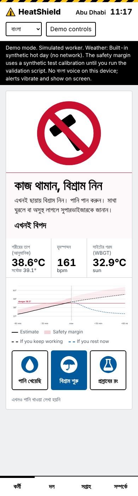
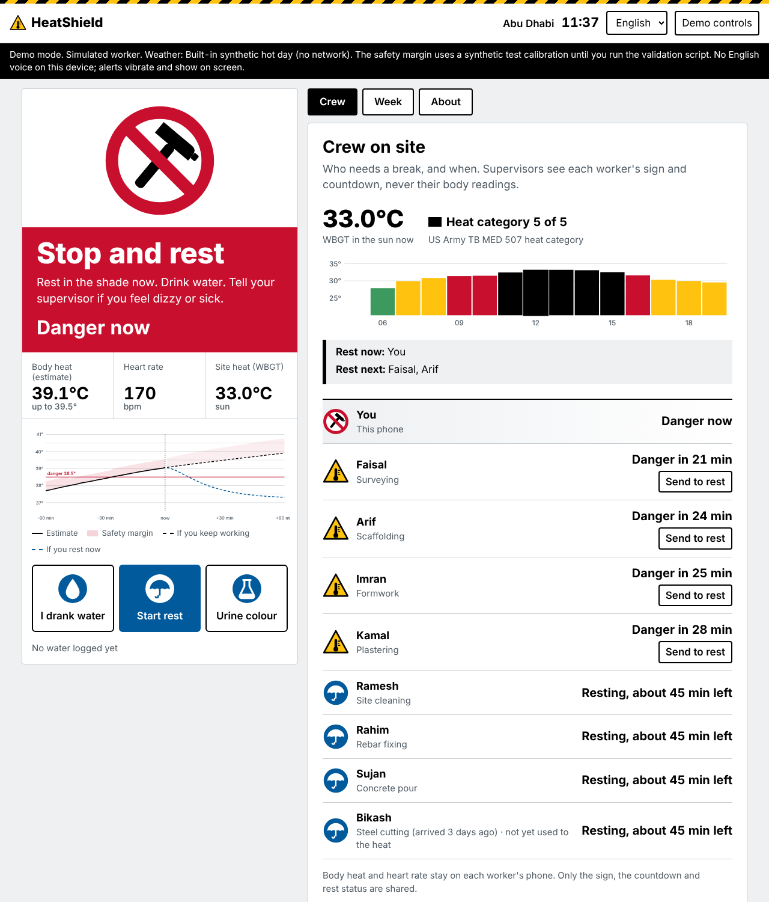

# HeatShield

**A heat-strain early warning for outdoor workers, built for the Future Health Digital Innovation Challenge 2026 (climate-resilient worker health).**

**Live prototype:** https://ibtida01.github.io/heatshield/app/  
**Demo video (3 min):**   
**Technical documentation:** [docs/TECHNICAL_DOCUMENTATION.md](docs/TECHNICAL_DOCUMENTATION.md)

<p>
  
  &nbsp;
  
</p>

## Why I built this

Every summer,construction workers in Abu Dhabi can spend hours in heat close to 50 °C. Most of the workers on those sites come from South Asia, a lot of them from Bangladesh,where I live.The UAE's midday break(no outdoor work 12:30 to 15:00 between 15 June and 15 September) protects the hottest part of the day.However,heat strain doesn't follow a clock.It depends on the person,the job and how long they've been in the country and the weather that day.

Some of the damage stays hidden.Kidney specialists in Dhaka have reported migrant workers coming home from the Gulf with kidney disease,which they link to years of working hot and dehydrated.Nobody on site saw it building up.

My Personal Experience: My friend Jamil(Mohiuddin Jamil),his father also died of Kidney complications who spent most of his life in the hot Middle East at a premature age.

I wanted something simple enough for a worker who may not read English or Arabic, and cheap enough that a contractor would actually hand it out.

## What it does

A worker wears an ordinary Bluetooth heart-rate band and keeps a phone in their pocket. HeatShield then:

1. **Estimates core body temperature every minute from heart rate**, using a published Kalman filter (Buller et al., 2013). No swallowed pill, no special sensor.
2. **Adds a safety margin** learned from real data with conformal prediction, and alerts on the top of that margin, so a hot worker isn't missed.
3. **Looks ahead.** It pulls the site's weather forecast and converts it to WBGT heat stress (Liljegren model). It then projects the next hour two ways, keep working or rest now, and shows "danger in 18 min" before the danger arrives.
4. **Speaks the worker's language.** Alerts come as safety signs (a green square, a yellow triangle, a red stop sign) and as voice alerts in Bengali, Hindi, Urdu, Nepali, Arabic or English.
5. **Keeps supervisors in the loop without exposing anyone.** The crew screen shows who should rest now and who next, but never anyone's heart rate or temperature.
6. **Remembers the week.** Repeated hard heat days are counted, and after three in a week the worker is prompted to get a simple kidney check. The app can share a short referral note with the clinic.

## Does it work?

I tested the estimator on two open datasets that I didn't collect and didn't tune on.

**Buono heat-tolerance dataset**: 65 people walking two hours on a treadmill in about 40 °C heat and in a cool room, with core temperature measured by a swallowed pill.

| | Result |
| --- | --- |
| Average error of the heart-rate estimate | 0.46 °C (bias +0.03 °C) |
| Dangerous minutes (core ≥ 38.5 °C) caught, estimate alone | 66% |
| Dangerous minutes caught, alerting on HeatShield's safety margin | **95%** |
| Safety margin coverage on people left out of calibration | 93% (target 90%) |

**Priego-Quesada dataset** (independent check): 20 people on a cycling test to exhaustion. Using the calibration above, unchanged, our heart-rate-only estimate had an error of 0.44 °C. A commercial heat-flux sensor in the same tests had 0.34 °C. It was within a tenth of a degree without any extra hardware.

I also checked our WBGT code against the PyWBGT reference implementation; it agrees within 0.01 °C.

To be clear about the limits: catching more dangerous minutes means more early alerts, and some of them turn out to be unnecessary. In the hottest range our margin covered 87% of cases, not 90%. Both datasets are lab exercise, not construction work in the sun. The full numbers, figures and caveats are in the [technical documentation](docs/TECHNICAL_DOCUMENTATION.md) and in `research/results/`.

## Try it

Open the [live prototype](https://ibtida01.github.io/heatshield/app/) on a laptop or phone. You'll see a simulated worker on a real summer day in Abu Dhabi (15 July 2025, weather from the Open-Meteo archive). Use **Demo controls** to speed up time, change the site or language, or switch the worker to "new arrival".

Some links that jump straight to the interesting moments:

| Link | What you'll see |
| --- | --- |
| [`?start=10&level=heavy&jump=40`](https://ibtida01.github.io/heatshield/app/?start=10&level=heavy&jump=40) | Heavy work mid-morning; the warning is about to appear |
| [`?lang=bn&start=10&level=heavy&jump=70`](https://ibtida01.github.io/heatshield/app/?lang=bn&start=10&level=heavy&jump=70) | Stop-and-rest alert in Bengali |
| [`?lang=ar&accl=no&start=9&jump=50`](https://ibtida01.github.io/heatshield/app/?lang=ar&accl=no&start=9&jump=50) | A worker who arrived three days ago, in Arabic |
| [`?tab=week&start=10&level=heavy&jump=120`](https://ibtida01.github.io/heatshield/app/?tab=week&start=10&level=heavy&jump=120) | The weekly heat load and the kidney-check prompt |

If you have a Bluetooth chest strap (Polar, Garmin, Coospo and similar), open Demo controls in Chrome and choose **Bluetooth band** to use your own heart rate.

- **Everything runs on the phone.** No server receives anyone's heart rate.
- **Rules make the alerts.** No language model decides whether someone is in danger and the thresholds are written down in the model card on the About screen.
- **Supervisors see signs,not vitals.** The terms rule out using HeatShield data for discipline,hiring ,pay or insurance.
- **Consent comes first.** A plain-language consent screen appears on first use and workers can delete their data at any time.
- **It's not a medical device, and it says so.** Anyone who feels dizzy,confused or sick needs first aid,whatever the screen shows.

## Run it yourself

The app is plain HTML, CSS and JavaScript, with no build step and no server.

```bash
git clone https://github.com/ibtida01/heatshield.git
cd heatshield/app
python -m http.server 8000      # then open http://localhost:8000
```

To reproduce the validation (Python 3.10+):

```bash
pip install -r research/requirements.txt
python -m pytest -q research/tests
python research/scripts/convert_datasets.py --htt "HTT data set.xlsx" --calera "dataset.xlsx" --out research/data
python research/scripts/validate_buono.py run research/data/htt_long.csv --subject-col subject --time-col minute --hr-col hr --tc-col tc --condition-col condition
python research/scripts/external_calera.py --data research/data/calera_long.csv
```

The two datasets aren't included in this repo; download them from Mendeley Data (links below). `node app/tests/parity.mjs` checks that the JavaScript models in the app give exactly the same numbers as the Python reference code.

## What's in the repo

```
app/        the web app (worker, crew, week and about screens)
research/   Python reference models, validation scripts, tests and results
docs/       technical documentation, screenshots, demo script
```

## What's real and what's simulated

As I couldn't manage a band,I had to use simualtion,I am trying to manage a band.
The models, the weather data and the validation results are real.In the demo the worker's heart rate is simulated,unless you connect a band.The crew of eight is also simulated and so are the earlier days in the Week screen; the app labels them. Because the simulator uses the same heart-rate relation as the estimator,the on-screen accuracy in demo mode looks better than reality,so please judge accuracy from the validation above.

## What's next

I'd like to run an eight-week pilot with one contractor alongside a field study with outdoor workers in Dhaka.(Can't afford to go to Abu Dhabi).In that study I'll measure kidney markers before and after shifts, to test whether the weekly heat-load score predicts early kidney strain.

## Team

- Ibtida Bin Ahmed
- Clinical advisor: Dr Shamimul Masud Ahmed, Advisor, Mymensingh Medical College (mailto:shamimul.mahmed@gmail.com)

Contact: (mailto:ibtida01.ahmed@gmail.com)

## Credits and licences

- Buller MJ et al. (2013), *Estimation of human core temperature from sequential heart rate observations*, Physiological Measurement.
- Liljegren JC et al. (2008), *Modeling the wet bulb globe temperature using standard meteorological measurements*, J Occup Environ Hyg.
- Moran DS et al. (1998), *A physiological strain index to evaluate heat stress*, Am J Physiol.
- Buono M, *Predicting heat tolerance status from exercise in thermoneutral conditions*, Mendeley Data, [doi:10.17632/g5sb382smp.1](https://data.mendeley.com/datasets/g5sb382smp), CC BY 4.0.
- Priego-Quesada JI et al., *Effect of aerobic fitness on the validity of the Calera Research sensor to estimate core temperature during exercise*, Mendeley Data, [doi:10.17632/z9f499kv9d.1](https://data.mendeley.com/datasets/z9f499kv9d), CC BY 4.0.
- Weather data: [Open-Meteo](https://open-meteo.com/), CC BY 4.0.

Code licence: MIT
